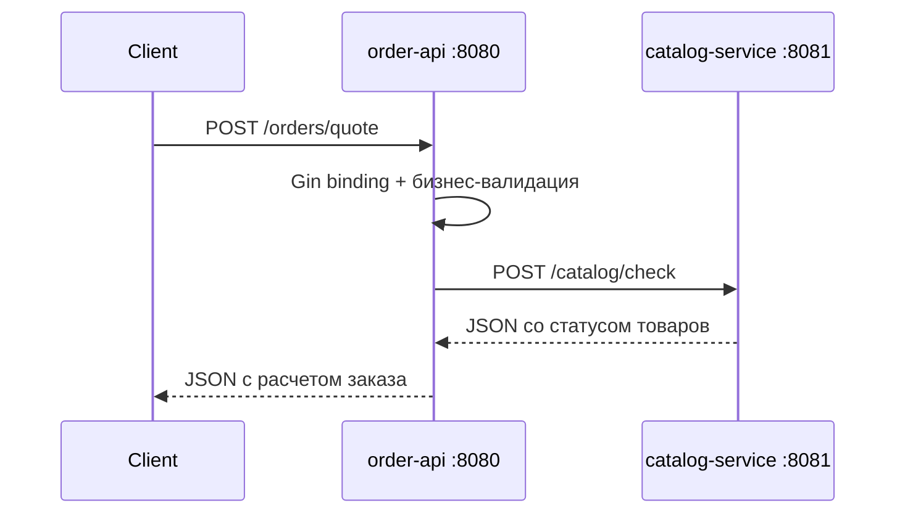

Орехов Артем Алексеевич, группа 221331, Лабораторная работа 10, Вариант 9, сложность средняя
# Лабораторная работа 10: задания средней сложности

Проект реализует выбранные задания средней сложности из методички:

1. Простое API на Go с Gin и 2-3 эндпоинтами.
2. Валидация входных данных в Go.
3. Передача сложных JSON-структур между сервисами.

## Архитектура

В проекте два Go-сервиса:

- `order-api` — публичный REST API на Gin.
- `catalog-service` — внутренний сервис проверки товаров.

`order-api` принимает сложный JSON заказа, валидирует поля, формирует вложенный JSON-запрос и отправляет его в `catalog-service`.



## Эндпоинты

### order-api

- `GET /health` — проверка доступности API.
- `GET /examples/quote` — пример корректного JSON-запроса.
- `POST /orders/quote` — расчет заказа и доставки.

### catalog-service

- `GET /health` — проверка доступности сервиса каталога.
- `POST /catalog/check` — проверка наличия товаров.

## Запуск

Установить зависимости:

```bash
go mod tidy
```

Запустить сервис каталога:

```bash
go run ./cmd/catalog
```

В отдельном терминале запустить API:

```bash
go run ./cmd/api
```

## Пример запроса

Получить пример тела запроса:

```bash
curl http://localhost:8080/examples/quote
```

Отправить расчет заказа:

```bash
curl -X POST http://localhost:8080/orders/quote \
  -H "Content-Type: application/json" \
  -d '{
    "request_id": "REQ-2026-0001",
    "customer": {
      "name": "Артем Иванов",
      "email": "artem@example.com",
      "phone": "+79990001122"
    },
    "delivery_to": {
      "city": "Москва",
      "street": "Тверская",
      "house": "10",
      "comment": "Позвонить за 10 минут"
    },
    "items": [
      {
        "sku": "BOOK-001",
        "name": "Go для начинающих",
        "quantity": 2,
        "price": {
          "amount": 1200,
          "currency": "RUB"
        }
      }
    ],
    "preferences": {
      "method": "courier",
      "date": "2026-06-01",
      "time_window": "day",
      "fragile": true,
      "allowed_zones": ["center", "north"]
    }
  }'
```

## Валидация

Валидация сделана на двух уровнях:

- через `binding`-теги Gin: обязательные поля, email, диапазоны, допустимые значения;
- через ручную бизнес-валидацию: дата доставки не в прошлом, цена больше нуля, валюта только `RUB`.

Пример ошибки:

```json
{
  "error": "preferences.date must not be in the past"
}
```
